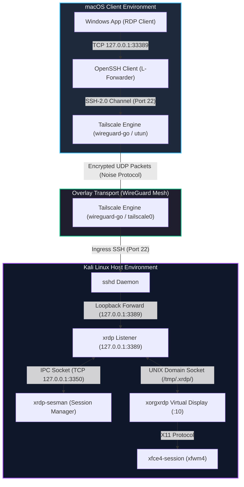

# System Architecture & Design Specification

This document provides a comprehensive technical breakdown of the headless remote workstation pipeline. It details the design rationale, component interaction models, protocol encapsulations, and hardware/kernel abstractions.

---

## 1. High-Level Topology & Data Flow

The system transforms a standard physical laptop into a headless compute and offensive-security node accessible over untrusted public networks without exposing services to the public internet.



---

## 2. Layer-by-Layer Architectural Decomposition

### Layer 1: Network Overlay & NAT Traversal (Tailscale & WireGuard)

Traditional VPN architectures depend on a centralized, static public IP (Hub-and-Spoke model). This architecture implements a **decentralized, point-to-point mesh** using Tailscale:

```text
[ Client (Mac) ] <════ Direct P2P WireGuard Tunnel ════> [ Host (Kali) ]
       │                                                         │
       └───> [ Tailscale Coordination Server (Control Plane) ] <───┘
             (Discovers Public Endpoints via STUN; Exchanging Keys)
```

1. **Control Plane vs. Data Plane:**
   * **Control Plane (Coordination Server):** Devices register their cryptographic public keys and exchange reflexive transport addresses gathered via **STUN (Session Traversal Utilities for NAT)**. No user payload traffic touches the control plane.
   * **Data Plane (Direct WireGuard Tunnel):** Once endpoint pairs are brokered, clients initiate direct bidirectional UDP hole punching. Traffic travels point-to-point without intermediaries.
2. **Userspace Implementation (`wireguard-go`):**
   * Tailscale implements WireGuard in userspace via `wireguard-go`, interacting with the operating system through virtual Layer 3 TUN interfaces (`utun` on macOS, `tailscale0` on Linux).
   * While kernel-space WireGuard avoids user-to-kernel context switching, `wireguard-go` provides cross-platform protocol consistency, integrated path discovery, and automatic fallback mechanisms.
3. **DERP (Designated Encrypted Relay for Packets):**
   * If symmetric enterprise NATs or institutional firewalls drop UDP packets entirely, Tailscale falls back to DERP relays.
   * Traffic is packaged into standard HTTPS/TLS frames over TCP port 443. Relays forward packets based strictly on destination public keys; payload contents remain cryptographically opaque to the relay.
4. **Endpoint Roaming:**
   * WireGuard associates peers with cryptographic public keys rather than network-level IP addresses.
   * When the macOS client switches physical networks (e.g., home Wi-Fi to a cellular hotspot), the source IP and port change. The client transmits an authenticated packet from the new endpoint.
   * The host verifies the cryptographic signature (Poly1305 MAC), dynamically updates its routing table with the client's new physical socket, and resumes transmission without renegotiating session state.

---

### Layer 2: Transport Security & Loopback Proxying (OpenSSH)

The pipeline employs an SSH local port forward as an intermediate proxy between the RDP client and the XRDP daemon:

$$\text{Mac}:\text{127.0.0.1:33389} \xrightarrow{\text{SSH-2.0 Channel}} \text{Kali}:\text{sshd} \xrightarrow{\text{Loopback}} \text{Kali}:\text{127.0.0.1:3389}$$

```text
+────────────────────────────────────────────────────────────────────────────+
|                           THE LOCAL PORT FORWARD                           |
|                                                                            |
|   Windows App ──> [127.0.0.1:33389]                                        |
|                          │                                                 |
|                   (OpenSSH Client)                                         |
|                          │                                                 |
|             === SSH-2.0 Encrypted Channel ===                              |
|                          │                                                 |
|                   (Kali sshd Daemon)                                       |
|                          │                                                 |
|                          └──> connect(127.0.0.1, 3389) ──> [xrdp]         |
+────────────────────────────────────────────────────────────────────────────+
```

#### Why Loopback Forwarding is Essential:
1. **Perimeter Firewall & ACL Bypass:** In default Tailscale setups, network ACLs or local firewall configurations (`iptables`/`nftables`) often drop inbound connections on non-standard ports (such as 3389) arriving on `tailscale0`. Because SSH (Port 22) is standard, it passes through unhindered.
2. **Defense-in-Depth Interface Binding:** By configuring XRDP to bind strictly to `tcp://127.0.0.1:3389`, the RDP port is entirely inaccessible from local LANs, public Wi-Fi, or the Tailscale interface directly. The *only* path to the display server is through an authenticated SSH session holding an authorized Ed25519 key.
3. **Double Cryptographic Wrapping:** The RDP data stream is encrypted by TLS, encapsulated inside an SSH-2.0 stream (ChaCha20-Poly1305 or AES-GCM), which is further encapsulated inside WireGuard UDP packets.

---

### Layer 3: Presentation & Display Virtualization (XRDP & XFCE)

The display subsystem decouples the graphical user interface from physical monitor hardware:

```text
[ macOS Windows App ]
         │ (RDP Protocol over Local Forward)
         ▼
+────────────────────────────────────────────────────────────────────────────+
| xrdp Listener Daemon (127.0.0.1:3389)                                      |
| - Manages RDP connection state machine (ITU-T T.125 / X.224)              |
| - Decodes client input events (mouse, keyboard, clipboard)                |
+────────────────────────────────────────────────────────────────────────────+
         │
         ├─── (TCP 127.0.0.1:3350) ───> [ xrdp-sesman ]
         │                               (PAM Auth & Session Lifecycle)
         │
         └─── (UNIX Socket: /tmp/.xrdp/xrdp_display_10)
                 │
                 ▼
+────────────────────────────────────────────────────────────────────────────+
| xorgxrdp (Headless X11 Display Driver on Display :10)                      |
| - Allocates framebuffers in RAM                                            |
| - Calculates dirty screen rectangles for differential RDP encoding         |
+────────────────────────────────────────────────────────────────────────────+
                 │ (X11 Core Protocol)
                 ▼
+────────────────────────────────────────────────────────────────────────────+
| Window Manager & Desktop (xfwm4 / xfce4-session)                           |
| - 2D software rasterization (no GPU/OpenGL dependencies)                   |
| - Independent from systemd user-session targets                            |
+────────────────────────────────────────────────────────────────────────────+
```

#### The Engineering Decision: XFCE over GNOME
During initial deployment, modern GNOME 40+ failed with **exit code 134 (`SIGABRT`)**. The architecture shifted to XFCE based on the following technical constraints:

* **Compositor Graphics Pipeline:** Modern GNOME depends on **Mutter**, a 3D-compositing window manager that assumes direct hardware acceleration (OpenGL/EGL via DRM/KMS). In a virtual display server (`xorgxrdp`), no direct GPU pipeline exists. Mutter encounters failed assertion checks when initializing software GL fallbacks under certain drivers, causing `SIGABRT`.
* **Resource Footprint:** XFCE relies on **`xfwm4`**, a non-compositing (or lightweight compositing) 2D window manager that writes directly to the X11 server framebuffer using software rasterization. This eliminates GPU driver panics, reduces memory overhead, and reduces network bandwidth requirements when streaming screen updates over RDP.
* **D-Bus Environment Hygiene:** `xrdp-sesman` launches sessions under an environment where leftover D-Bus variables (`DBUS_SESSION_BUS_ADDRESS`, `XDG_RUNTIME_DIR`) can cause systemd user-session collisions. Unsetting these variables in `/etc/xrdp/startwm.sh` ensures XFCE initializes an isolated, clean execution context.

---

### Layer 4: Kernel ACPI & Power Management Subsystem

Standard consumer laptops are engineered to enter power-saving sleep states when the lid is closed. In a headless server configuration, this behavior must be suppressed at the kernel and daemon level:

```text
[ Physical Lid Close Event ]
              │
              ▼
    (Kernel ACPI Driver)
              │
              ▼
   (/dev/input/event* Interrupt)
              │
              ▼
     [ systemd-logind ] ───(Reads logind.conf: HandleLidSwitch=ignore)───> [ Event Discarded ]
              │
      (If Target Triggered)
              │
              ▼
     [ suspend.target ] ───(Masked: Symlinked to /dev/null)───> [ Kernel Sleep Blocked ]
```

1. **ACPI Event Interception:**
   * Closing the laptop lid triggers an ACPI interrupt from the embedded controller (EC).
   * The kernel exposes this through the input subsystem (`/dev/input/eventX`).
   * `systemd-logind` captures the event. Configuring `HandleLidSwitch=ignore` and `HandleLidSwitchExternalPower=ignore` instructs the daemon to take no action upon receiving the signal.
2. **Systemd Target Masking (The Failsafe):**
   * Even with `logind.conf` configured, secondary power management frameworks (such as UPower or desktop daemons) can issue direct requests to sleep targets.
   * Executing `systemctl mask sleep.target suspend.target hibernate.target hybrid-sleep.target` creates symbolic links from these unit files directly to `/dev/null`. If any process issues an invocation to enter an ACPI S3/S0ix state, systemd treats the target as non-existent and refuses the transition.
3. **PCIe Active State Power Management (ASPM) & Wi-Fi:**
   * Wireless network interface controllers (NICs) often drop into low-power states (D3hot/D3cold) when display output ceases.
   * Setting `wifi.powersave = 2` inside NetworkManager disables dynamic 802.11 power saving, forcing the wireless chip to maintain full-power **D0 operational state**, preventing silent network drops while the host sits unattended.

---

### Layer 5: Data-at-Rest Security & The LUKS Boundary

The host utilizes **LUKS (Linux Unified Key Setup)** operating via the Linux kernel's **`dm-crypt`** subsystem:

```text
+────────────────────────────────────────────────────────────────────────────+
| UNENCRYPTED PRE-BOOT STAGE                                                 |
| - BIOS / UEFI initializes motherboard hardware                             |
| - GRUB bootloader executes from unencrypted /boot/efi partition            |
| - Minimal Linux kernel & initramfs load into RAM                           |
+────────────────────────────────────────────────────────────────────────────+
                                      │
                         [ LUKS PASSPHRASE PROMPT ]
                        (Halts execution; NO NETWORKING)
                                      │
                                      ▼
+────────────────────────────────────────────────────────────────────────────+
| ENCRYPTED RUNTIME STAGE (dm-crypt AES-XTS-PLAIN64)                         |
| - /dev/mapper/kali-root mounted as root filesystem                         |
| - systemd PID 1 initializes system services                                |
| - Daemons load into memory: NetworkManager, tailscaled, sshd, xrdp         |
+────────────────────────────────────────────────────────────────────────────+
```

#### The Security Threat Model & Architectural Trade-off:
* **The Benefit (Physical Theft Mitigation):** In the event of physical theft while the laptop is powered down or the lid is closed, the decryption keys are absent from volatile memory (RAM). The NVMe storage device is cryptographically protected against forensic extraction.
* **The Architectural Limitation:** Remote management is impossible across an unattended reboot. Because Tailscale, SSH, and networking drivers exist entirely within the encrypted root filesystem, they cannot initialize until the LUKS passphrase is submitted via the physical keyboard during the `initramfs` phase.

---

## 3. Comprehensive Component Responsibility Matrix

| Component | Host System | Operational Layer | Technical Function |
| :--- | :--- | :--- | :--- |
| **Tailscale Engine** | macOS / Kali | L3 Network Overlay | Manages `wireguard-go` TUN drivers, STUN endpoint discovery, and DERP relay fallbacks. |
| **OpenSSH Client/Server**| macOS / Kali | L4 Transport Proxy | Establishes authenticated port-forwarding channels; binds local/remote loopback sockets. |
| **xrdp** | Kali Linux | L7 Presentation | Implements RDP wire protocol, TLS termination, and input stream decoding on `127.0.0.1:3389`. |
| **xrdp-sesman** | Kali Linux | System Service | Authenticates users via PAM and coordinates session lifecycles across TCP port `3350`. |
| **xorgxrdp** | Kali Linux | Display Driver | Acts as a virtual video adapter inside Xorg, maintaining RAM framebuffers for Display `:10`. |
| **xfwm4 / XFCE** | Kali Linux | User Workspace | Executes desktop window management via 2D software rendering, bypassing GPU requirements. |
| **systemd-logind** | Kali Linux | Kernel ACPI Interface | Monitors `/dev/input` for lid switch events and suppresses ACPI S3 sleep transitions. |
| **Windows App** | macOS | L7 Client Application | Decodes RDP bitmap frames via Metal and maps keyboard scancodes and clipboard buffers. |