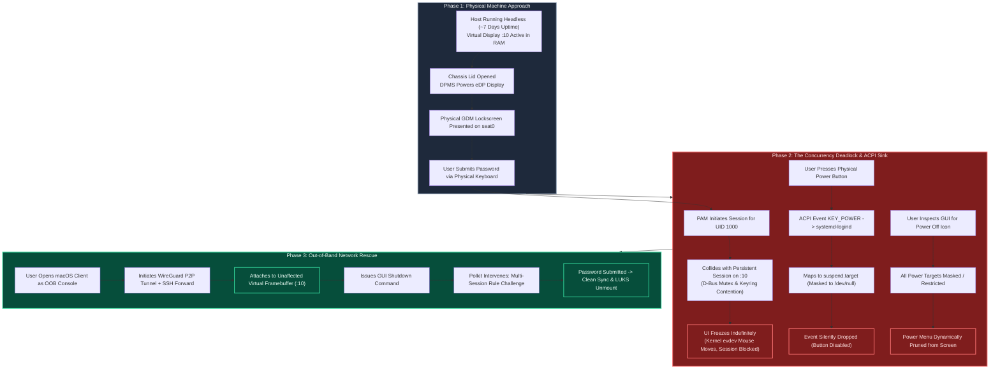
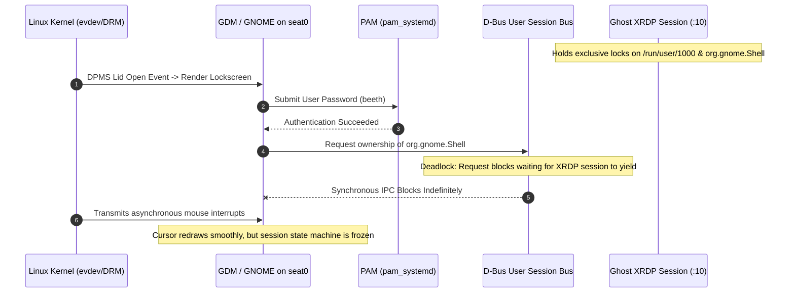
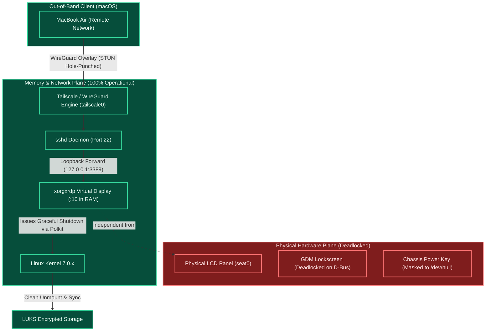

# Case Study & Post-Mortem: Multi-Seat Concurrency Deadlocks, ACPI Event Sinks, and Out-of-Band Remote Rescue

**Author:** Bhushan Ladgaonkar  
**Target Host:** Kali Linux (Rolling x86_64) on Lenovo IdeaPad (12th Gen Intel Core i5 / Iris Xe Graphics)  
**Host State:** 6+ days continuous headless uptime under LUKS Full Disk Encryption  
**Client:** Apple Silicon MacBook Air (macOS)  
**Classification:** Operating Systems Internals / Multi-Seat Resource Deadlock & Out-of-Band Recovery  

---

## 1. Executive Summary

Following a prolonged period of headless operation (nearly 7 days of continuous uptime with the laptop chassis lid shut), an attempt was made to operate the host as a traditional physical workstation. Upon opening the chassis lid and submitting credentials on the physical lockscreen, the host suffered an unhandled graphical session deadlock: while the kernel's asynchronous mouse pointer remained fluid, the user session transition hung indefinitely. 

Concurrently, physical chassis power key interrupts were silently discarded due to systemd sleep target masking, and lockscreen power management controls were dynamically pruned from the user interface. 

With the physical machine rendered inoperable to local human input, the system was recovered without data loss or filesystem corruption via an **ad-hoc Out-of-Band (OOB) management channel**: connecting from an external macOS client through an encrypted WireGuard/SSH tunnel into a healthy virtual framebuffer in RAM, successfully executing a graceful shutdown through PolicyKit privilege escalation.



---

## 2. Chronological Sequence of Events

| Timestamp | Control Plane | User Action / Event | Operating System Response | Resulting State |
| :--- | :--- | :--- | :--- | :--- |
| **$T_0$** | Background | Machine operating headless with lid closed for 6+ days. | In-memory X11 display (`:10`) running under `UID 1000`. Networking stack healthy. | Unattended server state. |
| **$T_1$** | Physical | User approaches laptop as a standalone PC; opens lid. | Embedded Controller (EC) signals kernel; DPMS wakes embedded DisplayPort (eDP). | GDM lockscreen presented on physical console (`seat0`). |
| **$T_2$** | Physical | User enters password and presses Enter. | PAM validates credentials; `pam_systemd` requests graphical session for `UID 1000`. | Authentication validated; session transition begins. |
| **$T_3$** | Physical | **Display state transition freezes.** | Single-user D-Bus mutex acquisition deadlocks against lingering background session. | **System hung.** Cursor tracks via raw `evdev`, but desktop never loads. |
| **$T_4$** | Physical | User presses physical chassis power key. | `systemd-logind` receives `KEY_POWER`; evaluates target `suspend.target` (`/dev/null`). | **No-op.** Power key completely inert. |
| **$T_5$** | Physical | User searches lockscreen for software shutdown icon. | GDM queries power capabilities; detects all valid sleep/power targets masked or locked. | **UI Pruning.** Shutdown button hidden from GUI. |
| **$T_6$** | Remote | User opens Mac client as an emergency management console. | Executes `rdp-kali` tunnel; connects Windows App to `127.0.0.1:33389`. | Immediate connection to virtual `Display :10` in RAM. |
| **$T_7$** | Remote | User issues shutdown command within remote GUI. | `systemd-logind` detects active physical session; flags remote multi-session poweroff. | Polkit spawns administrative authentication modal. |
| **$T_8$** | Remote | User enters sudo password into Polkit challenge. | System initiates graceful `poweroff.target`. | Background tasks terminated; LUKS drives safely unmounted. |

---

## 3. Deep-Dive Root Cause Analysis

### Incident 1: The Multi-Seat Mutex Deadlock
Why did the physical display lock screen accept credentials and freeze while the mouse pointer remained interactive?



#### 1. The Input Loop Isolation:
The mouse cursor continued to track because cursor drawing is handled asynchronously by the kernel's `evdev` input subsystem and the low-level compositor loop (`libinput`). The process rendering the cursor was not crashed; it was simply awaiting execution of the next state transition.

#### 2. The Singleton Session Paradigm:
Modern Linux desktop managers are engineered primarily under a **single physical seat assumption**. A user account (`beeth`, `UID 1000`) relies on shared singleton primitives:
* The user runtime directory: `/run/user/1000`
* The user session bus: `DBUS_SESSION_BUS_ADDRESS`
* The secret storage provider: `gnome-keyring-daemon`

Because the remote desktop architecture keeps sessions persistent in RAM, an earlier XRDP session was still executing on virtual `Display :10`. When GDM attempted to spawn a physical desktop on `seat0`, it executed a blocking synchronous IPC call:

```c
dbus_request_name(connection, "org.gnome.Shell", DBUS_NAME_FLAG_DO_NOT_QUEUE, &error);
```

Because the background session held the lock, and GDM on `seat0` could not acquire it, the state machine entered an unresolvable mutex deadlock. Neither process crashed, leaving the lockscreen visually intact but functionally frozen.

---

### Incident 2: The Physical Power Key Sink (ACPI Masking)
Why did pressing the physical power button on the Lenovo chassis produce zero response?


Modern PC chassis power buttons do not cut circuit power on a single press; they dispatch an ACPI interrupt (`KEY_POWER`) to `systemd-logind`. 

During host provisioning, to guarantee uninterrupted headless operation with the laptop lid closed, all sleep-related systemd targets were masked:
```bash
sudo systemctl mask sleep.target suspend.target hibernate.target hybrid-sleep.target
```

Because the OEM default policy in `/etc/systemd/logind.conf` often binds `HandlePowerKey` to `suspend`, `systemd-logind` captured the keypress and attempted to activate `suspend.target`. Because `suspend.target` was symlinked directly to `/dev/null`, systemd evaluated the unit as non-existent and discarded the interrupt. The hardware button was rendered entirely inert by software policy.

---

### Incident 3: Dynamic UI Pruning of Power Controls
Why did the graphical shutdown icon vanish from the physical lockscreen?

The GNOME Display Manager constructs its top-right utility menu dynamically by querying the system for permitted actions:
1. **Sleep Verification:** GDM evaluates `CanSuspend()` and `CanHibernate()` via `org.freedesktop.login1`. Because these targets are masked to `/dev/null`, the system returns `False`. The buttons are suppressed.
2. **Multi-Session Safety Policy:** GDM checks `CanPowerOff()` under a locked user session. Polkit security policy stipulates that an unauthenticated user at a lockscreen cannot unilaterally power down a workstation if active processes exist under another session (preventing data loss of background tasks).
3. **Menu Collapse:** With suspend disabled, hibernate disabled, and passwordless shutdown blocked by policy, the power sub-menu was left with **zero valid actions**. GDM's layout engine dynamically removed the power menu from the top bar entirely.

---

### Incident 4: Out-of-Band (OOB) Framebuffer Recovery

When physical human-interface devices (HID) and physical display seats fail, recovery is traditionally impossible without an ungraceful hardware hard-reset (holding the physical power button for 10 seconds), risking filesystem corruption on encrypted LUKS volumes.



#### The Architecture of the Rescue:
1. **Control Plane Separation:** The physical display pipeline (`seat0`, eDP panel, DRM/KMS master `/dev/dri/card0`) was frozen, but the Linux network stack, kernel scheduler, WireGuard overlay, and OpenSSH daemon operated in memory with zero dependencies on physical video hardware.
2. **Accessing the Shadow Framebuffer:** The macOS client established an authenticated SSH loopback forward to `127.0.0.1:33389`. XRDP attached to the persistent virtual framebuffer (`Display :10`) in RAM.
3. **PolicyKit Privilege Challenge:** Initiating shutdown remotely triggered the Polkit rule:
   ```text
   org.freedesktop.login1.power-off-multiple-sessions
   ```
   Because `systemd-logind` detected two concurrent sessions (the locked physical console and the incoming remote tunnel), it gated the action behind an administrative challenge. Entering the user's sudo password satisfied Polkit, safely terminating background daemons, flushing memory dirty pages, and cleanly unmounting the LUKS cryptographic volume.

---

## 4. Systems Engineering Lessons Learned

1. **The Fragility of Target Masking:** Using `systemctl mask` to silence lid-switch events is an unnuanced sledgehammer. It prevents unintended sleep, but it simultaneously disables chassis power buttons mapped to the same targets.
2. **Multi-Seat Concurrency Hazards:** Repurposing consumer Linux distributions into hybrid (simultaneously physical and remote) workstations introduces D-Bus and PAM race conditions. If remote sessions persist in background RAM, local display managers cannot cleanly initialize.
3. **The Power of Out-of-Band Abstraction:** This incident empirically demonstrated the core principle of enterprise data center architecture: **never rely exclusively on in-band physical consoles**. Decoupled, network-isolated virtual display pipelines provide a reliable mechanism for out-of-band recovery when physical human interfaces lock up.

---

## 5. Standard Operating Procedures (SOP) for Hybrid Hosts

### Prevention: Graceful Remote Teardown
If the host will be accessed physically, always terminate the remote X11 session cleanly before disconnecting:
```bash
xfce4-session-logout --logout
```

### Physical Recovery: Virtual TTY Escape
If the physical GUI lockscreen ever freezes, bypass the graphical display manager entirely by switching to a raw Linux virtual console:
1. Press **`Ctrl + Alt + F3`** on the physical keyboard.
2. Authenticate via pure CLI.
3. Restart the display manager to clear the deadlock without rebooting:
   ```bash
   sudo systemctl restart gdm3
   # or for lightdm:
   sudo systemctl restart lightdm
   ```