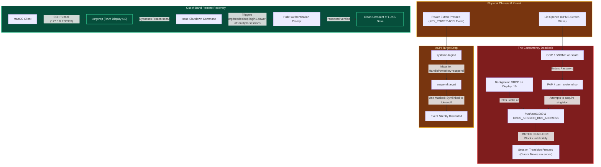

# Case Study & Post-Mortem: Multi-Seat Race Conditions, ACPI Masking, and Polkit Isolation

**Author:** Bhushan Ladgaonkar  
**System Under Test:** Kali Linux (Rolling x86_64) on Lenovo IdeaPad (12th Gen Intel Core i5 / Iris Xe Graphics)  
**Kernel:** Linux 7.0.x  
**Classification:** Operating Systems Internals / Concurrent Session State Deadlock  

---

## 1. Executive Summary

During testing of a headless, remote-access setup combining an in-memory virtual display (`Display :10` via `xorgxrdp`) with physical laptop hardware, the host experienced an unhandled system deadlock upon physical lid open. 

While the mouse cursor remained responsive, physical credential entry hung indefinitely, the physical chassis power key ceased functioning, and GUI power menus disappeared. Concurrently, an out-of-band Remote Desktop session over an SSH-tunneled WireGuard mesh remained responsive and successfully executed a graceful system shutdown after resolving an elevated PolicyKit authorization challenge.

This report documents the architectural root causes across four interacting OS subsystems: **D-Bus singleton mutex locks**, **Linux PAM multi-seat session conflicts**, **systemd ACPI event-to-target masking**, and **Polkit multi-session privilege boundaries**.



---

## 2. Chronological Sequence of Events

| Timestamp | Interface | Event / Action | System State |
| :--- | :--- | :--- | :--- |
| **$T_0$** | Remote | macOS connects via SSH/RDP; leaves session active on `Display :10`. | Headless X11 session executing in RAM under `UID 1000`. |
| **$T_1$** | Physical | Laptop chassis lid opened. | Embedded Controller (EC) signals kernel; DPMS re-energizes LCD panel. GDM lockscreen presented on `seat0`. |
| **$T_2$** | Physical | User enters password and submits credentials. | GDM validates password via PAM; attempts session transition. |
| **$T_3$** | Physical | **UI freezes.** Cursor moves, but desktop never renders. | **Deadlock:** Session transition blocked on D-Bus mutex acquisition. |
| **$T_4$** | Physical | User presses physical chassis power button. | **No action.** System ignores keypress completely. |
| **$T_5$** | Physical | User inspects lockscreen for software power icon. | **Absent.** Power management menu completely pruned from GUI. |
| **$T_6$** | Remote | Mac client connects over Tailscale via `127.0.0.1:33389`. | Remote session connects instantly to `Display :10`. Desktop fully interactive. |
| **$T_7$** | Remote | User clicks "Shut Down" within remote GUI. | Polkit spawns administrative password prompt (`org.freedesktop.login1.power-off-multiple-sessions`). |
| **$T_8$** | Remote | Password submitted; system shuts down cleanly. | LUKS encrypted volumes safely synchronized and unmounted. |

---

## 3. Deep-Dive Root Cause Analysis

### Incident 1: The Multi-Seat Mutex Deadlock
Why did the physical display lock screen accept the password and freeze with the mouse cursor still active?

1. **The Input Pipeline Separation:**
   Mouse tracking is handled asynchronously by the kernel's `evdev` driver and the base compositor's event loop (`libinput`). The compositor process was alive and consuming raw input interrupts, which is why the cursor moved smoothly.
2. **The Session Transition Lock:**
   When PAM validated credentials on `seat0`, GDM attempted to spawn the user workspace for `UID 1000`. In modern Linux desktop architectures (specifically GNOME/Systemd integration), user services depend on singleton abstractions:
   * **Runtime Path:** `/run/user/1000`
   * **IPC Bus:** Single session D-Bus daemon addressed by `DBUS_SESSION_BUS_ADDRESS`.
   * **Keyring:** `gnome-keyring-daemon` domain socket.
3. **The Race Condition:**
   The active background XRDP session already held exclusive possession of the user’s D-Bus session bus and active keyring sockets on virtual `Display :10`. When GDM’s worker spawned on physical `seat0`, it executed a blocking synchronous IPC call:
   $$\text{dbus\_request\_name}(\dots, \text{DBUS\_NAME\_FLAG\_DO\_NOT\_QUEUE})$$
   Because single-user desktop managers are historically architected under the assumption of a **single physical seat per user**, GDM and XRDP deadlocked waiting for shared lock releases that neither process would yield.

---

### Incident 2: The "Dead" Power Button (ACPI Event Sink)
Why did pressing the physical power key on the laptop chassis do absolutely nothing?

Modern ACPI power keys do not cut power electrically; they emit an ACPI interrupt (`KEY_POWER`) routed via the kernel input subsystem to **`systemd-logind`**.

```text
Chassis Power Button Pressed
          │
          ▼
Kernel ACPI Interrupt: KEY_POWER
          │
          ▼
systemd-logind Event Handler
          │
          ├─► Reads default action: HandlePowerKey=suspend
          │
          ▼
systemd initiates: systemctl start suspend.target
          │
          ▼
Evaluates /etc/systemd/system/suspend.target
          │
          ▼
Target is MASKED (Symlinked to /dev/null)
          │
          ▼
Instruction Dropped Silently (No-Op)
```

During initial headless provisioning, sleep targets were masked to prevent the laptop from suspending when the lid was closed:
```bash
sudo systemctl mask sleep.target suspend.target hibernate.target hybrid-sleep.target
```
Because `systemd-logind.conf` by default delegates single-press power key events to `suspend.target`, the daemon dutifully attempted to transition to sleep. Upon finding that `suspend.target` was linked directly to `/dev/null`, systemd aborted the operation silently. The operating system literally threw the power key interrupt into the trash.

---

### Incident 3: Dynamic UI Pruning of Power Controls
Why was there no option to power off the machine on the physical screen?

The GNOME Display Manager constructs its top-right system utility menu **dynamically** at runtime by querying `systemd-logind` and Polkit for supported features:

1. **Query Sleep Targets:** GDM queries: `CanSuspend()` and `CanHibernate()`.
   * *Response:* `False` (both targets masked to `/dev/null`).
   * *UI Action:* GDM suppresses the "Suspend" and "Hibernate" buttons.
2. **Query Session State:** GDM queries: `CanPowerOff()` under a *locked session state*.
   * *Response:* `False` without administrative privilege escalation. To prevent unauthorized passers-by from terminating a workstation with unsaved work, lockscreen power actions are restricted when background sessions are active.
   * *UI Action:* GDM suppresses the "Power Off" and "Restart" actions.
3. **The Null Set:** With all power states either masked by the kernel or restricted by policy, the UI layout engine had an empty button list and **rendered no power icon at all**.

---

### Incident 4: Out-of-Band RDP Recovery & Polkit Escalation
Why was Remote Desktop unaffected, and why did remote shutdown require a password?

1. **Virtual Framebuffer Independence:**
   XRDP operates via `xorgxrdp` on virtual `Display :10` in system RAM. It communicates with the OS network stack, completely isolated from physical seat allocation (`seat0`) and physical DRM/KMS hardware display pipelines (`/dev/dri/card0`). While the physical compositor was deadlocked, the network stack, SSH daemon, and virtual X11 server operated with zero degradation.
2. **PolicyKit Privilege Elevation:**
   When shutdown was triggered from within the remote session, `systemd-logind` evaluated the request against Polkit action rule:
   $$\text{\textbf{org.freedesktop.login1.power-off-multiple-sessions}}$$
   * *Policy Logic:* A local physical user sitting at `seat0` can shut down without a password because they have physical custody of the machine. However, an incoming remote user cannot unilaterally power down a machine if another session (in this case, the locked physical console) is active.
   * *Result:* Polkit intervened and generated a graphical authentication prompt, requiring `beeth`'s password before executing the systemd poweroff target.

---

## 4. Key Systems Engineering Takeaways

1. **The Single-Seat Linux Paradigm:** Modern consumer desktop environments (especially GNOME/Mutter) make hard assumptions regarding single-seat multi-tenancy. Running simultaneous headless virtual display servers (`xorgxrdp`) alongside physical display managers (GDM on `seat0`) for the identical UID inevitably leads to resource contention on user-level D-Bus sockets and PAM session registries.
2. **Target Masking Side Effects:** Using `systemctl mask` is an absolute hammer. While masking `suspend.target` successfully prevents lid-close sleeps, it silently neutralizes chassis hardware inputs that depend on those targets (such as the physical power button).
3. **Out-of-Band (OOB) Virtual Display Redundancy:** By maintaining a virtual display pipeline in RAM decoupled from physical video hardware, remote administrators retain command-and-control access even when local display servers or physical compositors suffer catastrophic deadlocks.

---

### Suggested Mitigation for Hybrid (Local/Remote) Workstations

To prevent physical lockscreen deadlocks while retaining headless capability:

* **Always log out of remote desktop sessions** prior to logging in physically:
  ```bash
  # Gracefully terminate the headless session from remote terminal
  xfce4-session-logout --logout
  ```
* **Use Virtual TTY Escape:** If the physical lockscreen hangs, switch to a native Linux virtual console via **`Ctrl + Alt + F3`**, log in via pure CLI, and restart the display manager without hard power-cycling:
  ```bash
  sudo systemctl restart gdm3
  ```

---
