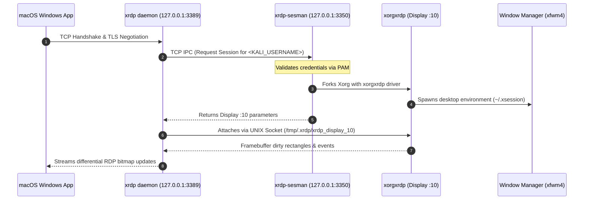
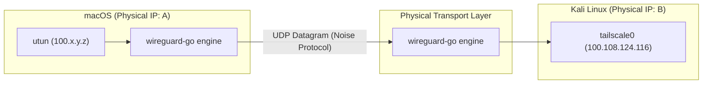
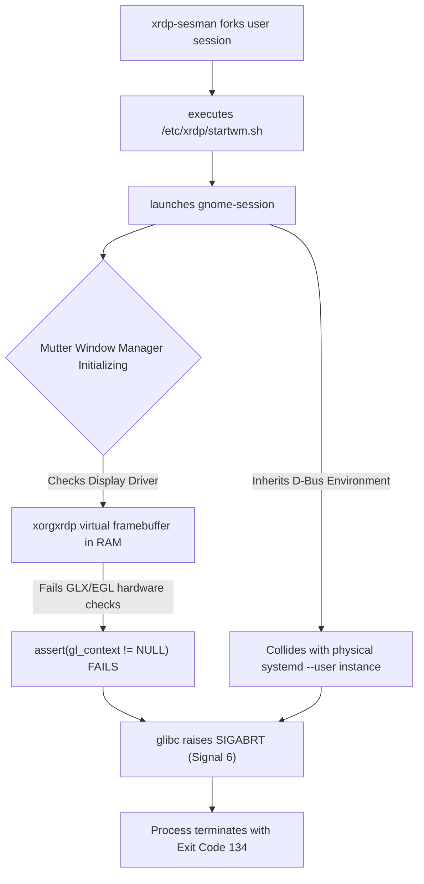

# Low-Level Protocol Internals & Engineering Deep Dives

This document provides a low-level technical exploration of the subsystems powering this architecture: the internal inter-process communication (IPC) of XRDP, the cryptographic mechanics of WireGuard endpoint roaming, a post-mortem analysis of the `SIGABRT` (exit code 134) failure mode, and the X11 clipboard architecture.

---

## 1. XRDP Subsystem & Inter-Process Communication (IPC)

XRDP does not execute as a single monolithic binary. It is split into distinct processes communicating across network and local IPC boundaries to enforce privilege separation and session isolation.



### The Communication Interfaces:
1. **Client $\leftrightarrow$ `xrdp` (`127.0.0.1:3389` via TCP):**
   * Listens for inbound client traffic over standard RDP framing (ITU-T T.125 / X.224 connection sequence).
   * Terminates TLS encryption and acts as a protocol translation proxy.
2. **`xrdp` $\leftrightarrow$ `xrdp-sesman` (`127.0.0.1:3350` via Localhost TCP):**
   * The listener daemon does not handle user authentication directly. It sends authentication tokens over a local TCP loopback socket on **port 3350** to `xrdp-sesman`.
   * `xrdp-sesman` runs with root privileges, interfaces with Linux **PAM (Pluggable Authentication Modules)**, validates the user's password, and allocates an available X11 display number (e.g., `:10`).
3. **`xrdp` $\leftrightarrow$ `xorgxrdp` (`/tmp/.xrdp/xrdp_display_*` via UNIX Domain Sockets):**
   * Once `sesman` spawns the user's X server instance, communication between `xrdp` and `xorgxrdp` switches to low-latency **UNIX domain sockets** located in `/tmp/.xrdp/`.
   * The `xorgxrdp` driver captures dirty screen rectangles from the X11 framebuffer in shared memory (`shm`), hands them across the UNIX socket to `xrdp`, which compresses them into RDP bitmap updates and transmits them to macOS.

---

## 2. WireGuard Engine & Dynamic Endpoint Roaming

Tailscale deploys **`wireguard-go`** in userspace across macOS and standard Linux hosts, abstracting the tunnel via Layer 3 virtual network interfaces (`utun` on macOS, `tailscale0` on Linux).



### Cryptographic State vs. Transport Connectionlessness

A common misconception is that WireGuard is entirely "stateless." In networking terms:
* **WireGuard is connectionless at the transport layer:** It runs exclusively over UDP without the multi-packet connection setup or teardown states of TCP.
* **WireGuard is stateful at the cryptographic layer:** It maintains an internal cryptographic session state based on the **Noise Protocol Framework (Noise_IKpsk2)**. 

Peers complete a 1-RTT authenticated handshake that derives ephemeral symmetric keys:
$$\text{Rekey Thresholds:} \quad T_{\text{time}} = 120\,\text{seconds} \quad \lor \quad T_{\text{data}} = 2^{64}-2^{16}-1\,\text{messages}$$

If no traffic traverses the tunnel, peers remain completely silent—transmitting no keepalive packets unless configured, making endpoints invisible to passive port scans.

---

### The Mechanics of Endpoint Roaming

When the client transitions between physical gateways (e.g., home Wi-Fi $\rightarrow$ cellular hotspot), standard TCP sockets fail because the physical socket 4-tuple is invalidated:

$$\text{Physical Socket} = (\text{Client IP}, \text{Client Port}, \text{Host IP}, \text{Host Port})$$

WireGuard decouples logical identity from physical routing using **Cryptokey Routing**:

```text
Host Internal Routing Table:
---------------------------------------------------------------------------------
Peer Public Key                    | Assigned Overlay IP | Last Valid Physical Endpoint
---------------------------------------------------------------------------------
K_pub_mac = "a8F3...9qZ=" (Mac)   | 100.x.y.z           | 198.51.100.4:41234 (Old)
```

1. **Gateway Change:** The Mac switches to mobile hotspot. The physical interface receives a new IP: `203.0.113.88:58210`.
2. **Authenticated Ingress:** The Mac transmits its next WireGuard packet from this new physical socket. The packet payload is encrypted, and the header contains an unencrypted 16-byte **Poly1305 Message Authentication Code (MAC)** calculated over the payload using the current session key.
3. **Endpoint Update:** Kali’s `wireguard-go` receives the datagram, verifies the Poly1305 MAC using the session key associated with `K_pub_mac`. Because the signature is cryptographically valid, spoofing is impossible.
4. **Dynamic Table Mutation:** Kali immediately updates its peer mapping:
   $$\text{Last Valid Physical Endpoint} \leftarrow 203.0.113.88:58210$$
   All future outbound packets are addressed to this new physical endpoint.
5. **Transport Persistence:** The inner SSH and RDP connections remain bound to the overlay addresses (`100.x.y.z` $\leftrightarrow$ `100.108.124.116`). The underlying TCP state machine experiences transient packet delay during the physical switch, triggers standard TCP retransmissions, and resumes data flow without terminating the session.

---

## 3. Post-Mortem: Exit Code 134 (`SIGABRT`) Analysis

During the initial deployment of GNOME 40+ on XRDP, sessions aborted immediately upon connection with the following log trace:

```text
[WARN ] Window manager (pid 45265, display 10) exited with non-zero exit code 134.
[WARN ] Window manager (pid 45265, display 10) exited quickly (0 secs).
```

### The Anatomy of Exit Code 134
In POSIX-compliant operating systems, process termination codes above 128 indicate termination by an unhandled signal:

$$\text{Exit Code} = 128 + \text{Signal Number}$$
$$\text{For Signal 6 (SIGABRT):} \quad 128 + 6 = 134$$

`SIGABRT` is initiated by the process itself calling the `abort()` system call, typically triggered by a failed assertion (`assert()`) or a critical runtime exception in glibc.



### The Dual Failure Mechanisms:

1. **Mutter 3D Compositing Pipeline Failure:**
   * Modern GNOME relies on **Mutter**, an opinionated 3D compositing window manager designed for physical hardware using direct DRM/KMS and OpenGL/EGL acceleration.
   * `xorgxrdp` provides a virtual 2D software framebuffer. When Mutter attempts to negotiate hardware acceleration contexts and fails to find compatible hardware DRI nodes, it aborts execution unless complex software rasterization fallbacks (`LIBGL_ALWAYS_SOFTWARE=1`) are configured.
2. **D-Bus & Systemd User-Session Collisions:**
   * Modern Linux desktop environments rely heavily on `systemd --user` session targets.
   * When `xrdp-sesman` spawned `gnome-session`, the process inherited lingering environment variables from the physical console session (`:0`):
     * `DBUS_SESSION_BUS_ADDRESS`
     * `XDG_RUNTIME_DIR`
   * `gnome-session` attempted to register itself with the active systemd session daemon of the physical user, encountered duplicate registration conflicts, and aborted.

### The Engineering Resolution:
* **Switching to XFCE (`xfwm4`):** XFCE's window manager operates natively as a 2D software-rasterized X11 client. It draws directly to the virtual X server framebuffer without requiring hardware OpenGL contexts.
* **Sanitizing the Startup Environment:** Adding explicit unsets to `/etc/xrdp/startwm.sh` ensures every spawned session initializes its own isolated D-Bus execution context:
  ```bash
  unset DBUS_SESSION_BUS_ADDRESS
  unset XDG_RUNTIME_DIR
  ```

---

## 4. X11 Clipboard Architecture & `autocutsel` Synchronization

Under native X11 environments, copy-paste failures frequently occur between macOS and Linux due to the fundamental architectural separation of X11 selections.

```text
+────────────────────────────────────────────────────────────────────────────+
|                           X11 SELECTION BUFFERS                            |
|                                                                            |
|  [ PRIMARY Selection ]                     [ CLIPBOARD Selection ]         |
|  - Populated by highlighting text          - Populated by explicit         |
|  - Pasted via Middle Mouse Click             Ctrl+C / Cmd+C                |
|                                            - Pasted via Ctrl+V / Cmd+V     |
+────────────────────────────────────────────────────────────────────────────+
                         ▲                                 ▲
                         │                                 │
                         └─────────── [ autocutsel ] ──────┘
                               (Synchronizes both buffers)
                                           │
                                           ▼
                                 [ xrdp-chansrv ]
                                           │
                                           ▼ (RDP Clipboard Channel)
                                 [ macOS NSPasteboard ]
```

### The Protocol Gap:
* **macOS:** Employs a single unified clipboard buffer accessed through Cocoa's `NSPasteboard` API.
* **X11 (Linux):** Maintains multiple distinct selection atoms defined by the Inter-Client Communication Conventions Manual (ICCCM):
  1. `PRIMARY`: Automatically stores whichever text is currently highlighted by the cursor. Pasted via middle-click.
  2. `CLIPBOARD`: Stores data explicitly copied via `Ctrl + C` or Edit $\rightarrow$ Copy menus. Pasted via `Ctrl + V`.

### Why the Sync Broke:
The XRDP channel server (`xrdp-chansrv`) bridges clipboard data between macOS and Linux. By default, `xrdp-chansrv` monitors only the X11 `CLIPBOARD` selection. If a Linux application updates only the `PRIMARY` selection (standard terminal highlighting), `xrdp-chansrv` detects no change, and the data is never pushed across the RDP virtual channel to macOS.

### The Resolution (`autocutsel`):
`autocutsel` runs as a lightweight daemon in the background of the user's desktop session (`autocutsel -fork`). It listens for X11 `SelectionNotify` events. Whenever either the `PRIMARY` or `CLIPBOARD` buffer changes, `autocutsel` synchronizes the contents into the other buffer, ensuring `xrdp-chansrv` reliably captures all copy events regardless of how they were initiated.

---

## 5. Defense-in-Depth: Network Interface Socket Binding

By default, the XRDP daemon configuration sets:
```ini
; Default xrdp.ini
port=3389
```
This instructs the daemon to call `bind()` on `0.0.0.0` (all IPv4 interfaces) and `::` (all IPv6 interfaces).

### Attack Surface Analysis of Default Binding:
* If the host joins an untrusted local network (e.g., home Wi-Fi with untrusted IoT devices or shared student housing), port 3389 is exposed to the entire local subnet.
* Any device on the local network can attempt to establish an RDP session, probe for vulnerabilities in XRDP's TLS/RDP parsing code, or brute-force user passwords.

### Hardened Loopback Configuration:
```ini
; Hardened xrdp.ini
port=tcp://127.0.0.1:3389
```
* **Kernel Enforcement:** By binding explicitly to the loopback interface (`127.0.0.1`), the Linux network stack drops all incoming packets destined for port 3389 that arrive on physical interfaces (`eth0`, `wlan0`) or the overlay interface (`tailscale0`).
* **Enforced Ingress Authentication:** The *only* process that can reach port 3389 is a process executing locally on the host. In our architecture, that is exclusively `sshd`, which requires an authenticated **Ed25519 public key** before granting access to the forwarded channel.

---

## 6. Official Resources & References

* **Tailscale Architecture:** [How Tailscale Works (David Crawshaw)](https://tailscale.com/blog/how-tailscale-works)
* **WireGuard Whitepaper:** [WireGuard: Next Generation Kernel Network Tunnel (Jason A. Donenfeld)](https://www.wireguard.com/papers/wireguard.pdf)
* **XRDP Source Implementation:** [GitHub: neutrinolabs/xrdp](https://github.com/neutrinolabs/xrdp)
* **Microsoft RDP Protocol Specifications:** [[MS-RDPBCGR]: Remote Desktop Protocol: Basic Connectivity and Graphics Remoting](https://learn.microsoft.com/en-us/openspecs/windows_protocols/ms-rdpbcgr/)
* **X11 ICCCM Specifications:** [Inter-Client Communication Conventions Manual (David Rosenthal)](https://www.x.org/releases/X11R7.6/doc/xorg-docs/specs/ICCCM/icccm.html)