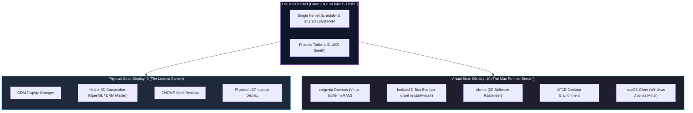

# Two Desktops, One Kernel: Running Simultaneous GNOME and XFCE on the Same Machine

A few days after diagnosing an OS deadlock on this setup, I stumbled across something that blew my mind:

I opened my Lenovo laptop, kept the lid open, and logged into my physical desktop as usual. It booted straight into **GNOME** on the physical laptop screen. Then, just out of curiosity, I opened my MacBook Air and clicked connect via Remote Desktop.

I fully expected one of two things to happen:
1. The remote desktop would show a black screen, or
2. The physical laptop screen would lock me out (like Windows does when you RDP into it).

Instead, **both screens were alive and fully functional at the same time.** 

My physical laptop was running **GNOME** on its built-in display, my Mac was running **XFCE** inside the Windows App over the network, both were logged in under the same user (`beeth`), and firing up `btop` showed CPU and memory usage from both devices on the exact same kernel.

Here is the breakdown of why this works, how Unix pulled off multi-display computing decades ago, and why our earlier configuration saved this from turning into another crash.

---

## 1. The Architecture: Two Displays, One Host

If you come from Windows or macOS, this feels like black magic. On Windows, if you RDP into a machine, the local console gets locked immediately. 

Linux doesn't work that way. It was born from Unix mainframe roots where a single central machine was designed to output to multiple independent graphical terminals at once.



---

## 2. Why Didn't They Fight? (The Technical Reasons)

Running two graphical interfaces simultaneously for the same user account should normally trigger race conditions. Three specific mechanisms made this work:

### A. Display Server Decoupling (`Display :0` vs `Display :10`)
In Linux, screens are network-transparent abstractions identified by numbers:
* **`Display :0` (or `:1`):** Owned by GDM on `seat0`. It talks directly to the physical Intel Iris Xe GPU driver (`/dev/dri/card0`) and drives the physical eDP laptop panel.
* **`Display :10`:** Created by `xorgxrdp`. It has no physical cables; it constructs a headless virtual framebuffer in system RAM.

They are completely isolated display canvases that don't know the other exists.

---

### B. The Unsung Hero: The `unset` Lines in `startwm.sh`
Remember when XRDP was crashing with **Exit Code 134** during initial setup, and we added this to `/etc/xrdp/startwm.sh`?

```bash
unset DBUS_SESSION_BUS_ADDRESS
unset XDG_RUNTIME_DIR
```

**This exact fix is why the laptop didn't freeze today.**

Normally, if you launch a second session under the same user, it inherits the active session's D-Bus bus address. Both desktops try to fight over the same session socket (`/run/user/1000`), causing an immediate lockup. 

Because we unset those variables, XRDP spawned XFCE with its **own isolated, fresh D-Bus communication bus**. GNOME on the laptop and XFCE on the Mac each had their own private communication channels.

---

### C. Window Manager Harmony (3D Mutter vs 2D xfwm4)
* **On the laptop screen:** GNOME uses **Mutter**, an opinionated 3D-compositing window manager that claims the GPU hardware pipeline.
* **On the Mac screen:** XFCE uses **`xfwm4`**, a classic 2D window manager that writes directly to the in-memory framebuffer using software rasterization.

Because XFCE doesn't demand hardware OpenGL master locks, it didn't try to wrest control of the Iris Xe GPU from GNOME. They shared the hardware without collision.

---

## 3. The `btop` Telemetry: Shared Brain, Separate Eyes

When you launch `btop` on either device, it shows the unified state of the system:

```text
Host: 82SF (IdeaPad 5 15IAL7)
CPU: [|||||||||||||||||||||         ] 64%
Mem: [||||||||||||||||              ] 9.76 GiB / 15.35 GiB

Process Tree (UID 1000 / beeth):
├─ gnome-shell          (Running on Display :0  -> Laptop Panel)
├─ nautilus             (Running on Display :0  -> Laptop Panel)
├─ xorgxrdp             (Virtual Display Driver -> In-RAM Buffer)
├─ xfwm4                (Running on Display :10 -> Mac RDP Stream)
├─ xfce4-panel          (Running on Display :10 -> Mac RDP Stream)
└─ qterminal            (Running on Display :10 -> Mac RDP Stream)
```

`btop` queries `/proc` directly from the Linux kernel. To the kernel, there is only one CPU scheduler, one pool of 16 GB RAM, and one user account (`beeth`). 

If I launch a heavy script in XFCE on my Mac, I can literally glance over at the physical Lenovo screen running GNOME and watch the CPU usage bars spike in real time.

---

## 4. Why Didn't It Deadlock Like the Post-Mortem?

In `DEADLOCK_POST_MORTEM.md`, we documented an ugly session lockup. Why did today's experiment work while that one failed?

It came down to **order of operations**:

* **The Deadlock Scenario:** The machine had been running headless for days with sleep targets masked. Opening the lid triggered a wake interrupt on a locked GDM screen, and GDM deadlocked trying to transition a session while `xorgxrdp` was already holding user locks.
* **This Scenario:** I logged into the physical screen with the lid open **first**. GNOME, PAM, and DRM master locks fully stabilized on `seat0`. *Then*, I initiated the virtual XFCE session on `:10` over the network, cleanly initializing an isolated D-Bus tree in memory.

---

## Summary

What started as a hack to avoid carrying two laptops to college accidentally turned an old Lenovo IdeaPad into a **multi-seat Unix workstation**. 

I can sit on the couch using GNOME directly on the laptop, hand my Mac to a friend across the room, and let them use the same machine over an encrypted WireGuard tunnel on XFCE—sharing RAM, compute, and storage with zero interference.

Unix got this right in the 1980s, and it's just as cool today.

---