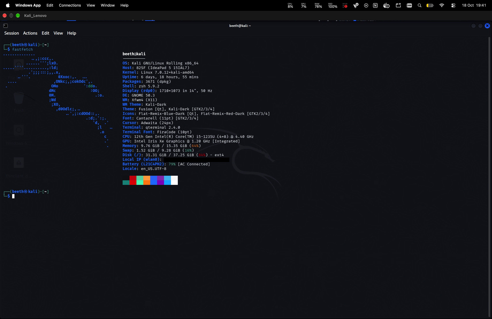
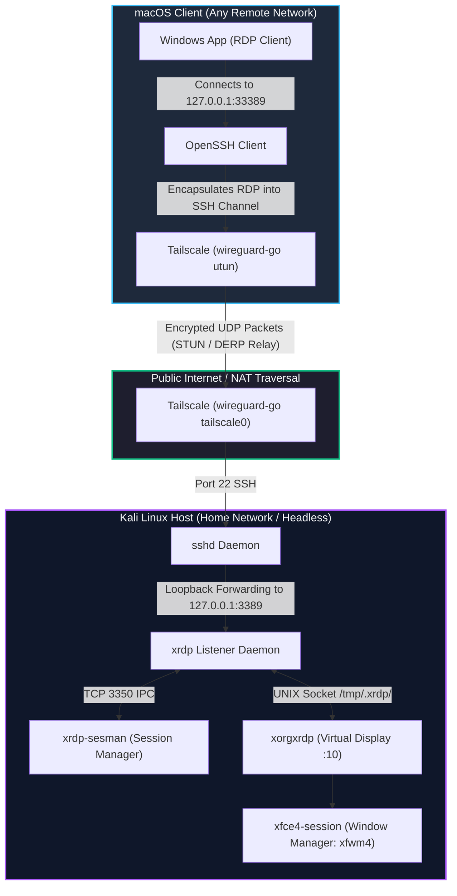

# Headless Kali Linux Workstation via macOS

[](LICENSE)
[]()
[](https://tailscale.com)

A production-grade, zero-trust blueprint to convert an encrypted physical Kali Linux laptop into a 24/7 headless remote workstation accessible from a Mac anywhere in the world—with zero port forwarding and complete disk theft protection.

<p align="center">
  
  <br>
  <em>Kali Linux (XFCE) running in Retina resolution on macOS via an SSH-tunneled WireGuard mesh.</em>
</p>

---

## ⚡ The 30-Second Summary

* **Zero Exposed Ports:** Tailscale establishes an encrypted peer-to-peer WireGuard mesh between macOS and Kali across residential, cellular, and institutional NATs.
* **Double-Encrypted Ingress:** RDP traffic binds strictly to `127.0.0.1` on Kali and is accessed via an SSH local port forward, bypassing external packet filtering and perimeter firewalls.
* **Lid-Closed Headless Mode:** ACPI sleep targets are masked at the `systemd` level, and Wi-Fi power-saving is disabled, allowing the host to run 24/7 with the laptop lid closed.
* **Data-at-Rest Protection:** Protected by LUKS Full Disk Encryption (FDE). If the laptop is stolen or powered off, data is cryptographically unreadable without the pre-boot passphrase.

> 📖 **Deep Dive Documentation:**
> * See [ARCHITECTURE.md](ARCHITECTURE.md) for the conceptual model, component breakdown, and system design.
> * See [INTERNALS.md](INTERNALS.md) for protocol teardowns (XRDP IPC, exit code 134 post-mortem, and WireGuard endpoint roaming).

---

## 1. System Architecture



---

## 2. Repository Structure

```text
.
├── ARCHITECTURE.md          # Mental model & component breakdown
├── INTERNALS.md             # Low-level protocol deep dives & IPC mechanics
├── LICENSE                  # MIT License
├── README.md                # Main documentation & quickstart
├── docs/
│   └── images/              # Architecture diagrams & screenshots
├── kali/
│   └── setup-kali.sh        # Kali host provisioning & ACPI hardening script
└── mac/
    ├── connect-kali.command # 1-click desktop automation launcher
    └── setup-mac.sh         # macOS client configuration script
```

---

## 3. Quickstart & Replication

### Prerequisites
* **Host:** A laptop running Kali Linux with root/sudo privileges.
* **Client:** A Mac running macOS 13+ with [Tailscale](https://apps.apple.com/app/tailscale/id1475387142) and [Windows App](https://apps.apple.com/app/windows-app/id1295203466) installed from the Mac App Store.
* A shared Tailscale account authenticated on both devices.

---

### Step 1: Provision the Kali Linux Host

1. Clone this repository on your Kali machine:
   ```bash
   git clone https://github.com/<YOUR_GITHUB_USERNAME>/headless-kali-mac.git
   cd headless-kali-mac
   ```

2. Make the host setup script executable and run it:
   ```bash
   chmod +x kali/setup-kali.sh
   ./kali/setup-kali.sh
   ```
   *This automated script:*
   * Installs `xrdp`, `xfce4`, `xfce4-goodies`, and `autocutsel`.
   * Sets `HandleLidSwitch=ignore` in `/etc/systemd/logind.conf`.
   * Masks `sleep.target`, `suspend.target`, `hibernate.target`, and `hybrid-sleep.target`.
   * Sets `wifi.powersave = 2` in NetworkManager (forces high-performance D0 state).
   * Disables conflicting `gnome-remote-desktop` user services.
   * Fixes Polkit color management popups via `/etc/polkit-1/rules.d/02-allow-colord.rules`.
   * Binds XRDP strictly to `127.0.0.1:3389` (defense-in-depth).
   * Configures `startwm.sh` and `~/.xsession` for stable XFCE rasterization.

3. Authenticate Tailscale and record your virtual IPv4 address:
   ```bash
   sudo tailscale up
   tailscale ip -4
   ```

---

### Step 2: Configure the macOS Client

1. Clone the repository on your Mac:
   ```bash
   git clone https://github.com/<YOUR_GITHUB_USERNAME>/headless-kali-mac.git ~/headless-kali-mac
   cd ~/headless-kali-mac
   ```

2. Run the client setup script:
   ```bash
   chmod +x mac/setup-mac.sh
   ./mac/setup-mac.sh
   ```
   *(You will be prompted for your Kali username, Tailscale IP, and Kali user password once to provision passwordless SSH keys).*

3. Configure the **Windows App** (formerly Microsoft Remote Desktop):
   * Click **+ Add PC**.
   * **PC Name:** `127.0.0.1:33389`
   * **Credentials:** Add user account (`<KALI_USERNAME>` / `<KALI_PASSWORD>`).
   * **Preferences (`⌘ + ,`) > General:** Check ✅ *"Use Mac shortcuts for copy, cut, paste and select all, undo, and find"*.
   * **Display Tab:** Check ✅ *"Update the session resolution on resize"*.

---

### Step 3: HiDPI Scaling (Retina Optimization)

On a Mac Retina display, native 100% resolution will make Linux UI elements appear small. To apply 2x integer scaling, run this inside a terminal on your Kali desktop:

```bash
xfconf-query -c xsettings -p /Gdk/WindowScalingFactor -s 2
```
*(To revert to 1x scaling, set `-s 1`).*

---

## 4. Daily Operation

### Method A: The 1-Click Desktop Launcher (Recommended)
Double-click the **`Connect-Kali.command`** file generated on your Mac Desktop. 

The script will:
1. Verify if the local SSH tunnel on port `33389` is running (spawning it in the background if absent).
2. Launch the Windows App directly into the session.
3. Automatically close its temporary terminal window.

### Method B: Manual CLI Connection
1. Ensure **Tailscale** is connected in the macOS menu bar.
2. Open your Mac Terminal and start the forwarded tunnel:
   ```bash
   rdp-kali
   # Equivalent to: ssh -N -L 33389:localhost:3389 <KALI_USERNAME>@<KALI_TAILSCALE_IP>
   ```
3. Open the **Windows App** and double-click `127.0.0.1:33389`.

---

## 5. Troubleshooting & Bug Post-Mortems

| Symptom | Mechanism / Root Cause | Resolution |
| :--- | :--- | :--- |
| **Error `0x204`** | Client cannot complete a TCP handshake to `127.0.0.1:33389`. | Ensure the SSH tunnel (`rdp-kali`) is actively running in the background and Tailscale is connected. |
| **Port 3389 bind failure (`errno=98`)** | `gnome-remote-desktop` is running as a user service and holds port 3389. | Run `systemctl --user stop gnome-remote-desktop` and restart `xrdp`. |
| **Exit code 134 (`SIGABRT`)** | Mutter 3D compositor crashes without GPU acceleration or collides with D-Bus environment variables. | Use XFCE (`xfwm4`) and ensure `unset DBUS_SESSION_BUS_ADDRESS` and `unset XDG_RUNTIME_DIR` are in `/etc/xrdp/startwm.sh`. |
| **Host sleeps on lid close** | ACPI lid event triggers systemd `suspend.target`. | Set `HandleLidSwitch=ignore` in `logind.conf` and mask all sleep targets with `systemctl mask sleep.target ...`. |
| **Wi-Fi drops when lid is closed** | NetworkManager power-saving switches the wireless NIC into PCIe D3 low-power state. | Write `wifi.powersave = 2` into `/etc/NetworkManager/conf.d/disable-wifi-powersave.conf`. |
| **Clipboard out of sync** | X11 primary selection and clipboard buffer separation. | Install `autocutsel` and execute `autocutsel -fork` inside `~/.xsession`. |

---

## 6. Security Considerations & Trade-offs

### Defense-in-Depth Model
* **Layer 3 (Overlay):** All inter-machine communication is encrypted via WireGuard (ChaCha20-Poly1305).
* **Layer 4 (Transport):** The RDP stream is enclosed within an SSH-2.0 tunnel authenticated via Ed25519 public keys.
* **Layer 7 (Application):** XRDP is bound strictly to `127.0.0.1:3389`, preventing direct access from any external or local subnet interface.

### The LUKS Encryption Trade-off
The host drive uses **LUKS Full Disk Encryption**. 
* **The Benefit:** If the laptop is physically stolen while powered off, data at rest is cryptographically protected against forensic extraction.
* **The Limitation:** If the host laptop experiences a hard reboot or power cycle while you are away, execution halts during the `initramfs` pre-boot stage. Because networking daemons (`tailscaled`, `sshd`) load *after* the root partition is decrypted, the machine cannot be reached remotely until the LUKS passphrase is typed on the physical keyboard.

---

## 7. License

This project is licensed under the [MIT License](LICENSE). Contributions, issues, and forks are welcome.