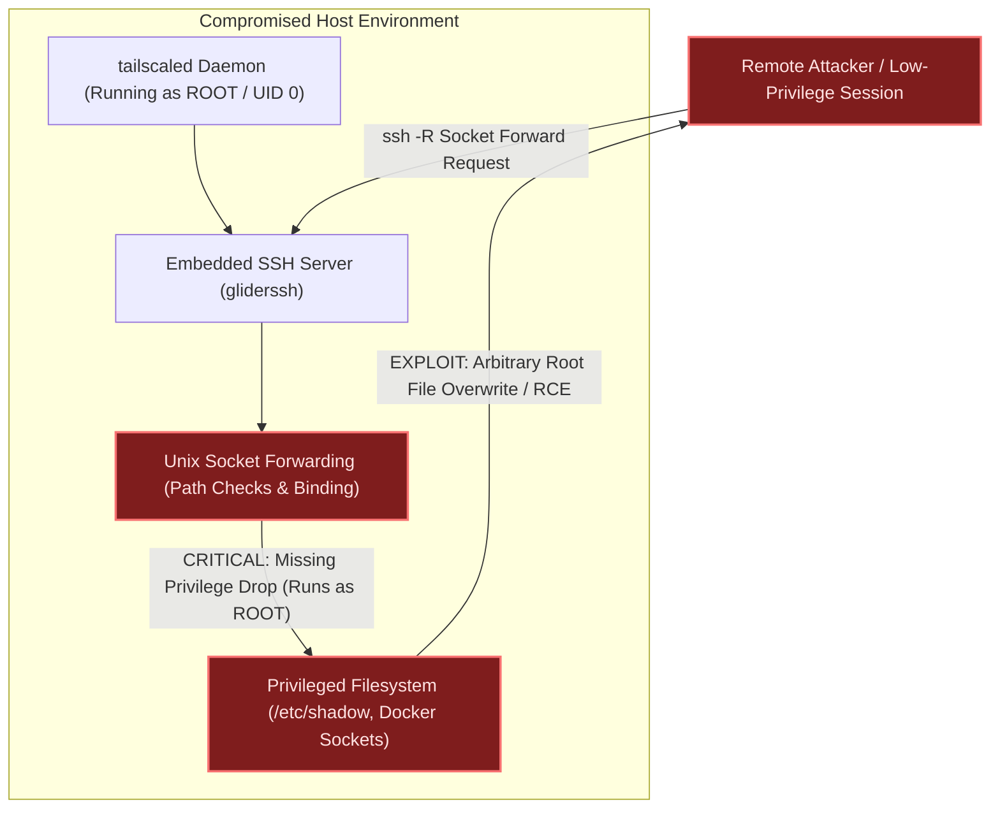
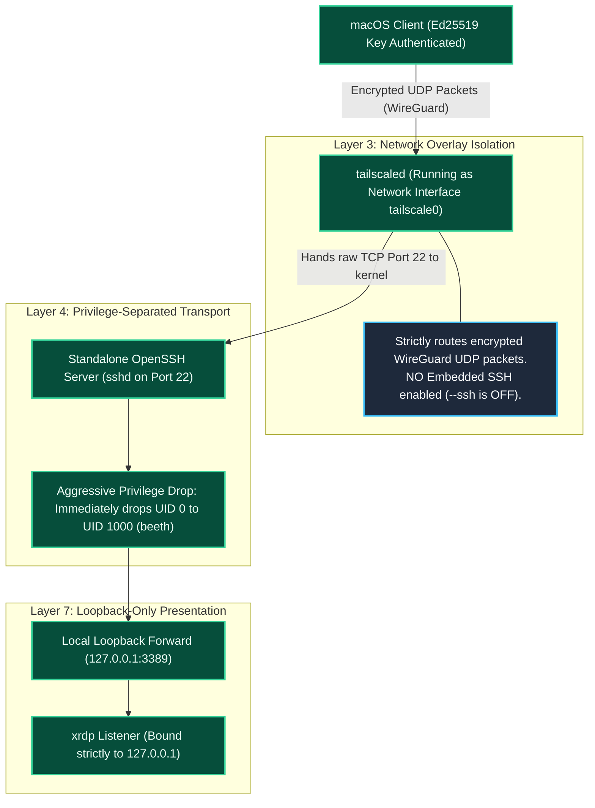

# Security Advisory: Immunity to Tailscale Embedded SSH Privilege Escalation ("Tailworm")

**Status:** UNAFFECTED BY DESIGN  
**Date:** October 2026  
**Vulnerability Target:** Tailscale Embedded SSH (`tailscale up --ssh` in `tailscaled`)  
**Scope:** `beeth73/headless-kali-mac` Architecture  

---

## 1. Context & Threat Overview

In late October 2026, security researchers (Cyberdione Labs) disclosed **"Tailworm"**, a set of high-severity vulnerabilities affecting **Tailscale SSH** and open-source control planes (`headscale`). 

The primary finding is a **privilege escalation vulnerability in `tailscaled`'s embedded SSH daemon**:
* Because the core background daemon `tailscaled` must configure network routes, TUN adapters, and packet filtering, **it executes permanently with full root privileges (`UID 0`)**.
* When Tailscale’s built-in SSH server (`gliderssh`) handles Unix domain socket forwarding (`ssh -R` / `ssh -L`), it executes filesystem path checks and socket binding operations **as root** without dropping down to the authenticated user's unprivileged UID.
* A Time-of-Check to Time-of-Use (TOCTOU) race condition allows an authenticated remote session to manipulate file links, overwrite root-owned files (e.g., `/etc/shadow`), and achieve instant root code execution on the host.

---

## 2. The Vulnerable Architecture vs. Our Hardened Pipeline

### Vulnerable Model (Embedded Tailscale SSH Monolith)
In systems that rely on Tailscale's built-in SSH convenience feature, the attack surface of the root networking daemon is exposed directly to application-layer socket forwarding:

---

### Our Hardened Model (Decoupled OpenSSH over L3 WireGuard Mesh)
In this project, Tailscale is strictly isolated to **Layer 3 network transport**. It handles WireGuard UDP packet routing and nothing else. Application authentication is handled exclusively by Linux's battle-tested OpenSSH daemon:

---

## 3. Why This Repository Is Immune

| Threat Vector | Tailscale SSH (`tailscale up --ssh`) | Our Pipeline (`beeth73/headless-kali-mac`) |
| :--- | :--- | :--- |
| **SSH Daemon Implementation** | Embedded Go SSH (`gliderssh`) compiled inside the root `tailscaled` process. | Independent, battle-tested OpenSSH server (`sshd`) managed by systemd. |
| **Daemon Privilege Model** | Runs permanently with root privileges (`UID 0`). | Uses strict Linux **privilege separation** (`UsePrivilegeSeparation sandbox`). |
| **Socket Forwarding Permissions** | Filesystem checks execute as root; vulnerable to TOCTOU symlink races. | Immediately drops privileges to `beeth` (`UID 1000`) before binding or checking files. |
| **Attack Blast Radius** | Vulnerability yields immediate **root execution** and cross-node escalation. | **Zero impact.** Embedded SSH is disabled; `tailscaled` acts strictly as an L3 packet pipe. |
| **RDP Ingress Exposure** | Directly accessible if Tailscale ACLs permit port 3389. | Bound strictly to `127.0.0.1:3389`; completely unreachable without verified Ed25519 SSH keys. |

---

## 4. Architectural Lessons in Secure Systems Design

The "Tailworm" vulnerability validates a fundamental law of secure systems engineering:

> **Beware of Feature Creep in Privileged Daemons.**

1. **The Monolith Anti-Pattern:** A daemon requiring root privileges to manipulate the Linux network stack (`tailscaled`) should never bundle application-layer services (SSH, web proxies, file servers). Any vulnerability in those high-level features inherits the root privileges of the parent process.
2. **The Unix Philosophy Wins:** By maintaining separation of concerns—using Tailscale **only** for WireGuard L3 routing, OpenSSH for L4 transport, and XRDP/XFCE for L7 display virtualization—we eliminated the entire vulnerability class.

Our pipeline remains verified, hardened, and safe against this advisory without requiring immediate mitigation patches.